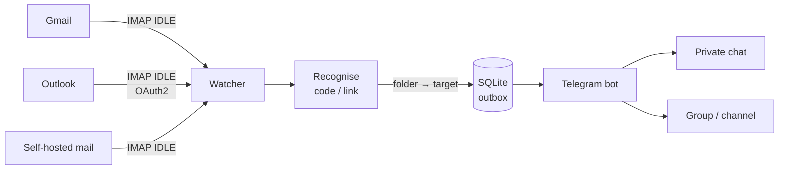

# verify-code-relay

[](https://github.com/lxtsuddy/verify-code-relay/actions/workflows/ci.yml)
[](LICENSE)

[繁體中文](README.md) | English

A self-hosted service that relays **verification codes** and **verification / sign-in / password-reset links** from your mailboxes to Telegram in real time.

It watches several mailboxes at once over IMAP IDLE. When a mail arrives it picks out the code or link, renders it with a template and sends it through a Telegram bot to the chats you choose. Multiple bots, chats and mailboxes are supported, and everything is configured in a web admin UI.

> **Note:** the web admin UI is in Traditional Chinese only. In these docs, UI labels are given in Chinese followed by an English translation, e.g. **系統設定 (Settings)**.

## Features

- **Real time**: IMAP IDLE push, with polling as a fallback for servers without IDLE. It reconnects on its own and catches up on mail received while disconnected.
- **Multilingual recognition**: codes and links in Traditional/Simplified Chinese, English and Japanese, including Big5, GB2312 and ISO-2022-JP mail. Both the HTML and the plain-text body are analysed.
- **Few false positives**: card number endings, postal codes, street addresses, phone numbers, amounts, order numbers, promo codes, newsletter links, and "if this wasn't you" account-recovery links are not mistaken for codes or sign-in links.
- **Tunable**: add your own keywords and rules (match sender or subject, give a regex, or skip). Upload a mail in the web UI to see exactly how it is recognised.
- **Telegram messages**: customisable templates; a "copy code" button, and link buttons labelled with the link text from the mail.
- **Routing**: per mailbox, map folder → target, e.g. inbox to your private chat and spam to a group.
- **Gmail, iCloud and self-hosted mail** with app passwords; **Outlook / Microsoft 365** with OAuth2, authorised from the web UI.
- **Web admin UI**: password + TOTP sign-in. Changes take effect on save, and every save is a version you can roll back to. Works on desktop and mobile.
- **Safe defaults**: strictly read-only on your mailboxes (never marks as read, moves or deletes). Codes and URLs are never written to logs or the forwarding history. You are notified of successful and suspicious sign-ins.
- A single binary with SQLite storage, shipped as an amd64 container image with K3s (Kustomize) manifests.

## How it works



Only mail that is recognised gets forwarded. For everything else only the sender and subject are recorded. Outgoing messages go to a database outbox first, so a Telegram outage or a restart loses nothing. Mail older than the age limit (10 minutes after receipt by default) is not forwarded, so you never get a stale code.

## Quick start (Docker, local trial)

```bash
cp .env.example .env                 # set RELAY_ADMIN_PASSWORD (at least 12 characters)
mkdir -p data && sudo chown 65532:65532 data   # the container runs as nonroot (UID 65532)
docker run -d --name relay --restart unless-stopped \
  --env-file .env -p 127.0.0.1:8080:8080 -v "$PWD/data:/data" \
  ghcr.io/lxtsuddy/verify-code-relay:latest
docker logs -f relay
```

Open `http://localhost:8080`, sign in with `RELAY_ADMIN_PASSWORD` and enrol TOTP. Then follow the steps on the dashboard:

1. **Telegram → Bot**: paste the token from [@BotFather](https://t.me/BotFather).
2. **Telegram → 目標 (Targets)**: send your bot a message, press 讀取最近對話 (Read recent chats) and pick the chat. Save, then press 發送測試 (Send test) to check that it arrives.
3. **信箱 (Mailboxes)**: pick a provider and enter the account and app password (Outlook uses Microsoft authorisation). Under 轉發路由 (Routes), map folder → target.
4. **系統設定 → 通知對象 (Settings → Notification target)**: pick a target for sign-in notifications and mailbox alerts (strongly recommended).

The session cookie is `Secure`, and browsers accept it only over HTTPS or on `http://localhost`. Signing in from another machine via `http://<IP>:8080` therefore does not work. Put the service behind an HTTPS reverse proxy for real use.

Image tags: `latest`, `0.3` (follows 0.3.x) and `0.3.1` (pinned). Pin a version for production; see [GitHub Packages](https://github.com/lxtsuddy/verify-code-relay/pkgs/container/verify-code-relay).

## Deployment

`deploy/k3s/` contains Kustomize manifests: a single replica, a `local-path` PVC for the database, non-root with a read-only root filesystem. Traffic comes in through a Traefik Ingress behind an HTTPS reverse proxy (Caddy in the examples):

```bash
cp .env.example deploy/k3s/secret.env   # set RELAY_ADMIN_PASSWORD
# set the host in deploy/k3s/ingress.yaml to your domain
kubectl apply -k deploy/k3s
```

The **[deployment guide](docs/deploy.en.md)** covers the full steps, the reverse proxy, real client IPs, upgrades and backups.

### Environment variables

All settings and secrets (bot tokens, app passwords, OAuth tokens, the admin account) live in the SQLite database. The process itself only reads these environment variables:

| Variable | Default | Description |
|---|---|---|
| `RELAY_DATA_DIR` | `/data` | Directory of the SQLite database |
| `RELAY_LISTEN` | `:8080` | Web admin UI |
| `RELAY_HEALTH_LISTEN` | `:8081` | Internal health checks (do not expose); empty disables it |
| `RELAY_ADMIN_PASSWORD` | (none) | Creates the admin account when the database has none yet; at least 12 characters |
| `RELAY_TRUSTED_PROXIES` | (empty) | Comma-separated CIDRs or IPs; only affects which client IP shows up in logs and notifications |

## Documentation

- [Deployment guide](docs/deploy.en.md): K3s, reverse proxy, real client IPs, day-to-day operations (upgrades, backups, testing mails).
- [Configuration](docs/configuration.en.md): Telegram, mailboxes (Gmail, iCloud, Microsoft), YAML import, CLI commands, health checks, forwarding history.
- [Recognition rules and templates](docs/recognition.en.md): how built-in recognition works, what to do when it gets a mail wrong, testing with a mail, message templates.

## Security

The admin UI can face the internet, but keep in mind:

- **Use a long random password**, ideally 20+ characters from a password generator. Sign-in is rate limited globally, but the account is never locked.
- **Sign in and enrol TOTP right after deploying.** The first sign-in only needs the password, so until TOTP is enrolled anyone who knows the password could enrol first.
- **Set a notification target.** You are notified of every successful sign-in, password change and TOTP re-enrolment. A correct password with a wrong code triggers an immediate alert, because it means your password has probably leaked.
- **Lost your phone or forgot the password?** Run `relay admin reset` on the server. It clears TOTP and signs out every device.
- **The database holds every secret**: bot tokens, app passwords, OAuth tokens, the password hash and the TOTP key. The output of `relay config export` contains secrets too. Keep the database, backups and exports safe, and never commit them to git.
- Stored secrets are never shown in web pages, error messages or logs. Token and password fields are write-only, and leaving one empty keeps the stored value.
- Do not expose the health check port 8081.

Please report security issues privately through GitHub [Security Advisories](https://github.com/lxtsuddy/verify-code-relay/security/advisories/new), not in a public issue.

## Development

Requires Go 1.26 or newer. To run without a container, install the binary directly (the web UI is embedded and no CGO is needed):

```bash
go install github.com/lxtsuddy/verify-code-relay/cmd/relay@latest
```

Working from source:

```bash
go test ./...                       # unit and integration tests (incl. an in-memory IMAP server and end-to-end tests through the web UI)
python3 testdata/eml/gen.py         # regenerate the recognition test mails
go build -o relay ./cmd/relay
RELAY_DATA_DIR=./data RELAY_ADMIN_PASSWORD='change-me-at-least-12-chars' ./relay run
# open http://localhost:8080
```

Recognition test mails live in `testdata/eml/`; each `.eml` has a `.expected.yaml` with the expected result. When fixing a recognition problem, please add a test mail that reproduces it, with personal data removed.

GitHub Actions runs `gofmt`, `go vet` and `go test -race` on every push and pull request. Pushing a `v*` tag builds the amd64 image and publishes it to `ghcr.io/lxtsuddy/verify-code-relay`.

## Acknowledgements

This project was inspired by:

- [XposedSmsCode](https://github.com/magisk317/XposedSmsCode), an Xposed module that recognises SMS verification codes and copies them to the clipboard.
- [smtp_to_telegram](https://github.com/KostyaEsmukov/smtp_to_telegram), a small program that receives mail over SMTP and forwards it to Telegram.

## License

[MIT](LICENSE)
