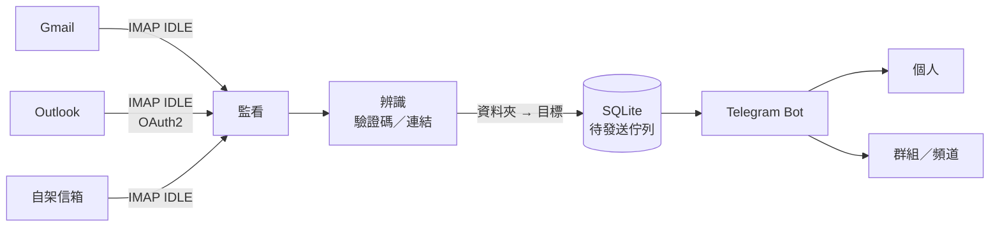

# verify-code-relay

[](https://github.com/lxtsuddy/verify-code-relay/actions/workflows/ci.yml)
[](LICENSE)

繁體中文 | [English](README.en.md)

把信箱裡的**驗證碼**與**驗證／登入／重設密碼連結**即時轉發到 Telegram 的自架服務。

以 IMAP IDLE 同時監看多個信箱，信一到就辨識出驗證碼或連結，套用範本後透過 Telegram Bot 送到指定的聊天室；可同時管理多個 Bot、多個聊天室與多個信箱。所有設定都在 Web 管理介面完成。

## 功能

- **即時**：IMAP IDLE 推送，伺服器不支援時改為輪詢；斷線自動重連並補抓斷線期間的信。
- **多語系辨識**：繁中、簡中、英文、日文的驗證碼與連結；支援 Big5、GB2312、ISO-2022-JP 等編碼，HTML 與純文字內文都會分析。
- **排除誤判**：卡號末碼、郵遞區號、地址、電話、金額、訂單編號、優惠碼、電子報連結、帳號被盜時的補救連結都不會被當成驗證碼或登入連結。
- **可調整**：自訂辨識關鍵字與規則（依寄件者、主旨比對，指定正規表示式或略過），在網頁上傳信件即可測試辨識結果。
- **Telegram 訊息**：可自訂範本；「複製驗證碼」按鈕，連結按鈕以信裡的連結文字命名。
- **路由**：每個信箱以「資料夾 → 目標」設定轉發，例如收件匣送個人、垃圾郵件匣送群組。
- **Gmail、iCloud、自架信箱**用應用程式密碼；**Outlook／Microsoft 365** 用 OAuth2，在網頁上完成授權。
- **Web 管理介面**：密碼＋兩步驟驗證（TOTP）登入，存檔即生效，每次存檔留下一個版本可還原；桌機與手機都能用。介面為繁體中文。
- **安全的預設**：對信箱完全唯讀（不標已讀、不移動、不刪除）；驗證碼與網址不寫進日誌與轉發紀錄；登入成功與異常時通知你。
- 單一執行檔、SQLite 儲存，提供 amd64 容器映像與 K3s（Kustomize）設定。

## 運作方式



只轉發辨識成功的信；其他信件只記錄寄件者與主旨。待發送的訊息先寫進資料庫，Telegram 暫時無法連線或重新啟動都不會遺失；超過時效（預設收信 10 分鐘內）的信不會轉發，以免送出過期的驗證碼。

## 快速開始（Docker，本機試用）

```bash
cp .env.example .env                 # 填入 RELAY_ADMIN_PASSWORD（至少 12 個字元）
mkdir -p data && sudo chown 65532:65532 data   # 容器以 nonroot (UID 65532) 執行
docker run -d --name relay --restart unless-stopped \
  --env-file .env -p 127.0.0.1:8080:8080 -v "$PWD/data:/data" \
  ghcr.io/lxtsuddy/verify-code-relay:latest
docker logs -f relay
```

用瀏覽器開 `http://localhost:8080`，以 `RELAY_ADMIN_PASSWORD` 登入、綁定兩步驟驗證，再依總覽頁的步驟設定：

1. **Telegram → Bot**：貼上 [@BotFather](https://t.me/BotFather) 給的 token。
2. **Telegram → 目標**：先對 Bot 傳一則訊息，再按「讀取最近對話」選擇聊天室，存檔後按「發送測試」確認收得到。
3. **信箱**：選擇服務、填入帳號與應用程式密碼（Outlook 用 Microsoft 授權），在「轉發路由」設定「資料夾 → 目標」。
4. **系統設定 → 通知對象**：選一個目標接收登入通知與信箱告警（強烈建議）。

登入 cookie 帶有 `Secure`，瀏覽器只在 HTTPS 或 `http://localhost` 接受，所以從其他電腦以 `http://<IP>:8080` 連線無法登入。正式使用請放在 HTTPS 反向代理後面。

映像標籤：`latest`、`0.3`（追蹤 0.3.x）、`0.3.1`（固定版本）。正式部署建議固定版本，見 [GitHub Packages](https://github.com/lxtsuddy/verify-code-relay/pkgs/container/verify-code-relay)。

## 部署

`deploy/k3s/` 提供 Kustomize 設定：單一 replica、`local-path` PVC 存放資料庫、以非 root 及唯讀根檔案系統執行，經 Traefik Ingress 與 HTTPS 反向代理（範例為 Caddy）對外：

```bash
cp .env.example deploy/k3s/secret.env   # 填入 RELAY_ADMIN_PASSWORD
# 修改 deploy/k3s/ingress.yaml 的 host 為你的網域
kubectl apply -k deploy/k3s
```

完整步驟、反向代理、真實 IP、升級與備份見 **[部署指南](docs/deploy.md)**。

### 環境變數

所有設定與機密（Bot token、應用程式密碼、OAuth token、管理員）都存在 SQLite 資料庫；程式只從環境變數讀取下列程序層級設定：

| 變數 | 預設 | 說明 |
|---|---|---|
| `RELAY_DATA_DIR` | `/data` | SQLite 資料庫目錄 |
| `RELAY_LISTEN` | `:8080` | Web 管理介面 |
| `RELAY_HEALTH_LISTEN` | `:8081` | 內部健康檢查（不要對外）；設成空字串代表不啟動 |
| `RELAY_ADMIN_PASSWORD` | （無） | 只在資料庫還沒有管理員時用來建立管理員，至少 12 個字元 |
| `RELAY_TRUSTED_PROXIES` | （空） | 以逗號分隔的 CIDR 或 IP；只影響記錄與通知中的 IP 是否準確 |

## 文件

- [部署指南](docs/deploy.md)：K3s、反向代理、真實 IP、日常操作（升級、備份、測試信件）。
- [設定說明](docs/configuration.md)：Telegram、信箱（Gmail、iCloud、Microsoft）、匯入 YAML、指令、健康檢查、轉發紀錄。
- [辨識規則與範本](docs/recognition.md)：內建辨識怎麼運作、辨識錯誤時怎麼調整、用信件測試、訊息範本。

## 安全

管理介面可以放在公網，但請注意：

- **密碼要長且隨機**：建議用密碼產生器產生 20 個字元以上。登入有全域限速，但不會鎖定帳號。
- **部署後立即登入並綁定 TOTP**：首次登入只需要密碼，綁定之前任何知道密碼的人都能搶先完成綁定。
- **設定通知對象**：每次登入成功、修改密碼、重新綁定 TOTP 都會通知；密碼正確但驗證碼錯誤時會立即告警（代表密碼可能已外洩）。
- **遺失手機或忘記密碼**：在伺服器上執行 `relay admin reset`，會清除 TOTP 並登出所有裝置。
- **資料庫含所有機密**：Bot token、應用程式密碼、OAuth token、密碼雜湊與 TOTP 金鑰都在資料庫裡，`relay config export` 的輸出也含有機密。資料庫、備份與匯出檔都要妥善保管，不要提交到 git。
- Web 頁面、錯誤訊息與日誌都不會顯示已儲存的機密；token 與密碼欄位只能寫入，留空代表不變。
- 健康檢查埠 8081 不要對外暴露。

發現安全問題請透過 GitHub 的 [Security Advisories](https://github.com/lxtsuddy/verify-code-relay/security/advisories/new) 私下回報，不要開公開 issue。

## 開發

需要 Go 1.26 以上。不用容器時，也可以直接安裝執行檔（Web 介面已內嵌，不需要 CGO）：

```bash
go install github.com/lxtsuddy/verify-code-relay/cmd/relay@latest
```

從原始碼開發：

```bash
go test ./...                       # 單元與整合測試（含記憶體 IMAP 伺服器與經由 Web 的端對端測試）
python3 testdata/eml/gen.py         # 重新產生辨識測試信件
go build -o relay ./cmd/relay
RELAY_DATA_DIR=./data RELAY_ADMIN_PASSWORD='change-me-at-least-12-chars' ./relay run
# 瀏覽器開 http://localhost:8080
```

辨識的測試信件在 `testdata/eml/`，每封 `.eml` 搭配一個 `.expected.yaml` 寫明預期結果；修正辨識問題時請一併加入重現的測試信件（請先移除個人資料）。

GitHub Actions 在每次 push 與 pull request 時執行 `gofmt`、`go vet` 與 `go test -race`；推送 `v*` 標籤時建置 amd64 映像並發布到 `ghcr.io/lxtsuddy/verify-code-relay`。

## 致謝

本專案受到以下專案啟發：

- [XposedSmsCode](https://github.com/magisk317/XposedSmsCode)：辨識簡訊驗證碼並複製到剪貼簿的 Xposed 模組。
- [smtp_to_telegram](https://github.com/KostyaEsmukov/smtp_to_telegram)：接收 SMTP 郵件並轉發到 Telegram 的小程式。

## 授權

[MIT](LICENSE)
